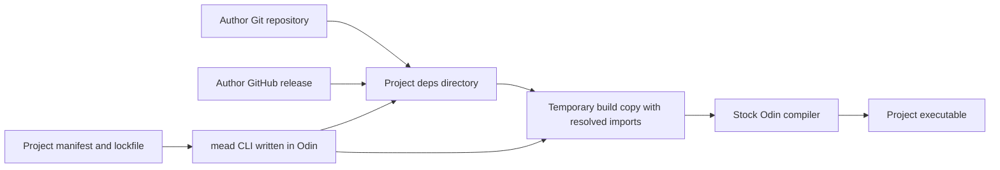

# Mead design proposal

Mead gives the consumer direct control over repository origins and revisions.
The author keeps package metadata beside the source.
The consumer commits `meade.kdl` and a lockfile, while mead installs dependencies under the project's ignored `deps/` directory.
Developer source uses bare names such as `import example "example_pkg"`.

All behavior here is proposed.
The first implementation milestones form a smaller subset of this design.
Milestones 1 through 3 are now implemented. [Implementation status](implementation.md) records the details and differences.

## Distribution and storage



The installation root is always the project's `deps/` directory.
Source dependencies retain complete repository layouts under `deps/<name>/`.
Tools and their artifacts use `deps/.tools/<name>/`.

An optional shared fetch and artifact cache can reduce repeated downloads and builds.
On Linux, its default root is `$XDG_CACHE_HOME/mead`, with `~/.cache/mead` as the fallback.
Other platforms use their normal user-cache directories.
`MEAD_CACHE_DIR` can override the cache root.
The cache does not replace the project-local installation root.

The source identity contains the repository origin, Git object format, and exact commit.
The selected package path refers into a complete checkout, so relative imports retain the author's repository layout.
Mead never edits an installed or shared checkout to adapt imports or build a package.
Builds use a generated working copy under `.mead/build/`.

The project contains a generated `.mead/` directory:

```text
project/
  meade.kdl                 # Committed dependency choices and build targets
  mead.lock                 # Committed exact identities, without local paths
  src/
    main.odin               # Imports example_pkg by its bare name
  deps/                     # Ignored installed dependencies
    example_pkg/            # Full upstream repository
      src/geometry/         # Selected source package in this example
    .tools/
      assetgen/
        source/             # Tool source repository
        bin/                # Tool executable and runtime files
  .mead/                    # Ignored generated state and builds
    state.json              # Local import bindings and artifact locations
    build/                  # Temporary copies with resolved import paths
    bin/                    # Project build outputs
```

`/deps/` and `/.mead/` belong in the project's `.gitignore`.
Mead does not modify the compiler's `core` or `vendor` collections.
An explicit future export command can support source delivery requirements and air-gapped environments.

## Manifest contract

The exact manifest filename is `meade.kdl`.
`schema 1` identifies the mead schema, independently of the KDL specification version.
The reader targets KDL 2.0.0.
The same format serves consumer projects and author repositories.

| Node or property | Meaning |
| --- | --- |
| `package "name"` | Local package name and optional version metadata. The name is not a registry identity. |
| `package` property `path` | The default source package path for consumers. Default: `.`. |
| `dependencies { dependency "name" ... }` | Source libraries with bare import names and direct Git origins. |
| `tools { tool "name" ... }` | Project tools, their direct Git origins, and the author's target names. |
| `targets { target "name" ... }` | Local build targets with kinds and repository-relative paths. |
| `flags "flag" ...` inside a target | An ordered list of compiler arguments. |
| `git` | A Git URL. Initially support HTTPS and SSH origins. Credentials never belong in this file. |
| `tag`, `branch`, `rev`, `release` | Mutually exclusive revision selectors. Exactly one is required. |
| `path` on a dependency | The repository-relative package directory. It overrides the author's package path. |
| `distribution` on a tool | `build` or `asset`. The initial tool implementation supports `build`. |
| `target` on a tool | The named executable target in the author's manifest. |

A `release` selector names the exact GitHub release tag, rather than its display title.
Mead also records the release ID after resolution.
An explicit prerelease selection is valid.
An exact `tag` or `rev` can select any valid Git revision without a GitHub release.

Mead rejects unknown nodes and properties, unsupported schema versions, duplicate names and properties, multiple selectors, and invalid target kinds.
Each dependency name is one portable directory component and a valid Odin identifier.
Names contain no import prefixes, path separators, or version suffixes.
Names that collide on a supported filesystem are invalid within one dependency scope.
Paths must remain inside the selected checkout after normalization and symlink resolution.
Mead owns output, collection, target-platform, and build-mode arguments.
Author flags cannot override them.
Mead preserves comments during edits or shows a replacement manifest for review if its writer cannot preserve them.

Examples use fictitious author repositories.
They describe the schema and do not claim that those repositories or releases exist.
See [the examples](../examples/README.md).

### Packages without a mead manifest

A source library does not require an author manifest.
The consumer supplies the repository, selector, bare dependency name, and source package path.
Mead fetches that source without an author registration step.

Mead does not infer every transitive dependency from Odin imports.
The consumer must declare external dependencies that those packages require.
The initial tool build requires an author manifest with an executable target.
A consumer-defined build target for older repositories is a later extension.

### Future version ranges

A later schema extension can introduce `version`, `version-source`, and `prereleases` as an alternative selector.
`version-source` explicitly chooses Git tags or GitHub release tags.
Mead compares candidates through SemVer and retains the original tag spelling.

The first range grammar can support exact versions and comma-separated comparisons, such as `>=1.2.0,<2.0.0`.
Mead must document this grammar. It does not follow from the SemVer standard.
Stable releases are the default candidates for a range.
Tags that do not follow SemVer remain available through exact selectors.

## Lockfile contract

`mead.lock` uses JSON because mead generates it and Odin includes JSON support.
The lockfile records:

- The schema version and a hash of the dependency and target declarations.
- Credential-free repository origins and the requested selectors.
- Fully qualified refs, Git object formats, and full resolved commit IDs.
- Bare dependency names, relative package paths, and dependency relationships.
- Selected release IDs and asset IDs, with SHA-256 digests and target metadata where applicable.
- Author target definitions and their source commits.

Machine-specific absolute paths belong in `.mead/state.json`, outside the lockfile.
Locally built artifact keys also include the compiler fingerprint, target, compiler flags, and complete dependency graph.
The fingerprint includes the compiler binary and its core/vendor sources or an equivalent toolchain digest.
An `odin version` string alone cannot distinguish all compiler builds.
Relevant native toolchain inputs also contribute to the key.

This key supports cache reuse. It does not guarantee byte-for-byte reproducible output from every upstream build.
Release assets always retain their own byte digests.

`mead install --locked` requires a compatible lockfile and unchanged dependency declarations.
It fetches missing locked commits, but it does not resolve new branch heads or versions.
`mead update <alias>` performs that resolution explicitly and reports the old and new identities.
An exact commit selection stays exact during an update.

Moved tags or replaced release assets cannot silently alter a locked installation.
If the locked object or asset is unavailable, installation fails with the missing identity.
`--offline` permits only locally available objects, metadata, and required artifacts.
It performs no network requests.

## Discovery and selection

`mead versions <git-url>` shows releases, version tags, other tags, and branches.
The output identifies each choice's kind, exact ref, commit when available, and prerelease status.
It also shows release assets and whether target compatibility information exists.

Generic Git supplies refs.
The GitHub adapter supplies release metadata and asset downloads.
Discovery follows pagination, caches HTTP responses, and respects server retry instructions.
GitHub tokens come from the environment and never enter manifests, locks, or logs.

Source installations need no registry account.
Git uses the developer's existing SSH and credential configuration.
Mead rejects unsupported origin schemes and passes subprocess arguments as separate values, without shell interpolation.

## Bare dependency imports

The consumer names a dependency in `meade.kdl`:

```kdl
dependencies {
    dependency "example_pkg" git="https://github.com/example-author/geometry.git" release="v1.2.3" path="src/geometry"
}
```

Mead installs that repository under `deps/example_pkg/`.
`path="src/geometry"` selects its source package.
The developer writes exactly:

```odin
import example "example_pkg"
```

`example` is the local Odin identifier. It can differ from the dependency name.
`example_pkg` is the manifest name. It needs no `deps/` component, collection prefix, or version suffix.

### Compiler adapter

Stock Odin resolves bare imports relative to the importing file's directory.
There is no documented flag that turns `deps/` into an implicit dependency search path.
The inspected source also resolves these imports through the source file's base directory.
[Import resolution source](https://github.com/odin-lang/Odin/blob/be869ce072704649eb64c139dfb74977c2bab857/src/parser.cpp#L6786).

Mead builds a temporary copy under `.mead/build/<build-id>/project/`.
This copy preserves the project's source layout, dependency repository layouts, and required assets.
The adapter identifies ordinary import declarations through Odin's parser or tokenizer.
It replaces only literals that exactly match declared dependency names.

For a file at `src/main.odin`, the compiler receives this import in the generated copy:

```odin
import example "../deps/example_pkg/src/geometry"
```

That generated path never enters the developer's source file.
Imports of the same locked package resolve to one physical package directory in the build copy.
Package identity must not depend on the number of importers or local aliases.

The adapter preserves local relative imports, compiler collections, foreign imports, asset paths, comments, and unrelated strings.
It respects platform build tags and imports inside conditional declarations.
If a declared dependency name also resolves to a local package, mead reports an ambiguity.
Dependency imports can then use a different manifest name, while local imports can use an explicit relative path.

Mead stages source files as independent copies or safe copy-on-write files.
Hard links that permit writes to installed source are invalid.
The source map associates generated filenames and edited spans with original files for compiler diagnostics.
Odin source-location constants can still expose generated paths. The initial experiment must document this behavior.

This adapter is proposed and requires an Odin compiler experiment before support claims.
The acceptance cases include nested source directories, shared package types, conditional imports, assets, and accurate diagnostics.
Plain `odin build` on the original source does not perform mead's dependency resolution.

### Editor integration

Bare names also require integration with the editor's import resolver.
An `ols.json` collection entry cannot change the meaning of an unprefixed import.
Mead needs a language-server adapter or a synchronized build view with original-file mapping.
That integration must support unsaved edits and navigation to installed dependency source.
It is a separate acceptance requirement, not an existing OLS feature.
[OLS collection configuration](https://github.com/DanielGavin/ols#configuration).

## Tool and binary integration

A tool declared with `distribution = "build"` uses the locked source and the author's executable target.
Mead controls the output location and installs the result under `deps/.tools/<name>/bin/`.
Windows executables use the appropriate filename extension.
`mead exec <alias> -- <arguments>` runs that project's selected tool.
Default installations do not modify the user's global `PATH`.

Build targets are declarative Odin invocations.
The initial design has no automatic author-provided shell hooks.
Mead verifies dependencies and builds in an isolated working directory.
This directory prevents cache mutations. It is not a security sandbox.

For future `distribution = "asset"` tools, the selected release must declare an exact asset and a compatible target.
The developer can choose a source build instead.
Mead does not choose a binary solely from filename heuristics.
Fallback from a requested asset to a source build must be explicit.

An author's future asset contract must describe the OS, architecture, runtime requirements, archive layout, and entry executable.
It must also identify the asset by release ID and asset ID, with a digest.
Mead preserves required runtime libraries and data files beside the executable.
Extraction rejects files that escape the installation directory.

Compiled-library support is a separate later feature.
The author must supply export definitions, bindings, ABI metadata, and static/shared target information.
Bindings remain necessary even if mead installs a library binary.
Runtime initialization, allocation ownership, and supported compiler combinations require explicit validation.

## Dependency graph policy

The initial implementation supports direct dependencies only.
It must report unsupported author-declared transitive dependencies rather than ignore them.
Consumers can declare the complete required set themselves.

A later milestone reads dependencies recursively from the locked author manifests.
The first graph implementation permits one revision per repository origin within a project compilation.
It rejects conflicting revisions, incompatible selectors, dependency-name collisions, and dependency cycles with their dependency paths.
Each author manifest defines its own bare dependency names.
The adapter resolves those names in that manifest's scope, then targets the graph's canonical package directories.

Tools build in separate compiler invocations with separate graphs.
Root overrides can later provide explicit origins and revisions for conflicting dependencies.
An override must satisfy the graph's declared constraints or produce a clear error.

## Proposed commands

| Command | Result |
| --- | --- |
| `mead init` | Create a minimal `meade.kdl` manifest. |
| `mead versions <git-url>` | List direct origin choices without installing them. |
| `mead add <git-url> --as <alias> --tag <tag>` | Record an exact dependency selection. Branch, commit, and release flags are alternatives. |
| `mead install` | Resolve initial selections or reuse an unchanged lockfile, then install dependencies and tools under `deps/`. |
| `mead install --locked` | Require an unchanged manifest and install the locked identities. |
| `mead update <alias>` | Resolve that selection again and update the lockfile. |
| `mead build <target>` | Resolve bare dependency names in a build copy and compile the target. |
| `mead run <target> -- <args>` | Build and run a project target. |
| `mead exec <tool> -- <args>` | Run an installed project tool. |
| `mead tree` | Show dependency origins and locked revisions. |
| `mead env` | Show dependency-name bindings, installed paths, and project tool locations. |

`install` stops if an existing lockfile disagrees with the manifest.
An explicit update regenerates the affected selections.
Network or build errors must leave the previous lockfile and working project tools usable.
Mead writes new state atomically after successful preparation.
Cache writes use per-entry locks and temporary directories before atomic publication.

## Odin implementation milestones

| Milestone | Deliverable | Meaningful acceptance evidence |
| --- | --- | --- |
| 1. Manifest and discovery | Odin CLI, KDL parser audit, schema validation, Git refs, and GitHub release pagination. | Read `meade.kdl`. Reject duplicate properties and selectors. List tags, branches, prereleases, and release pagination correctly. |
| 2. Locked source builds | Exact installations under `deps/`, lockfile, bare-import adapter, and project build/run. | The requested bare import builds from root and nested packages. Shared types retain identity. Assets work. Original source remains unchanged. A moved branch preserves locked behavior. |
| 3. Source-built tools | Author executable targets, artifact keys, and project-local tool execution. | Two projects use different tool revisions. A failed build preserves the installed tool. A compiler change invalidates the artifact key. |
| 4. Dependency graphs | Recursive manifests, scoped names, explicit conflicts, and root overrides. | A diamond dependency has one consistent revision and package identity. A conflict reports both paths. Cycles and name collisions fail clearly. |
| 5. Release assets and ranges | Explicit asset contracts, digest verification, and documented SemVer ranges. | Target mismatches and changed bytes fail. Offline mode never accesses the network. Numeric version ordering handles `1.9.0` and `1.10.0`. |
| 6. Compiled libraries | An author-defined binding and ABI contract for static/shared libraries. | A small exported API builds, links, and runs on each supported platform with its bindings. |
| Editor integration | Bare-name resolution with a synchronized view or language-server adapter. | Unsaved source receives diagnostics at original locations. Navigation opens installed dependency source. |

An initial Linux target keeps the first implementation small.
Windows and macOS need subprocess, path, cache, and toolchain validation before support claims.
Mead itself stays in Odin.
Git and libcurl can provide transport without a Rust, JavaScript, or Python implementation of the package manager.

The KDL parser audit and the bare-import compiler adapter are the first technical experiments.
The binary-library experiment follows only after those foundations work.
